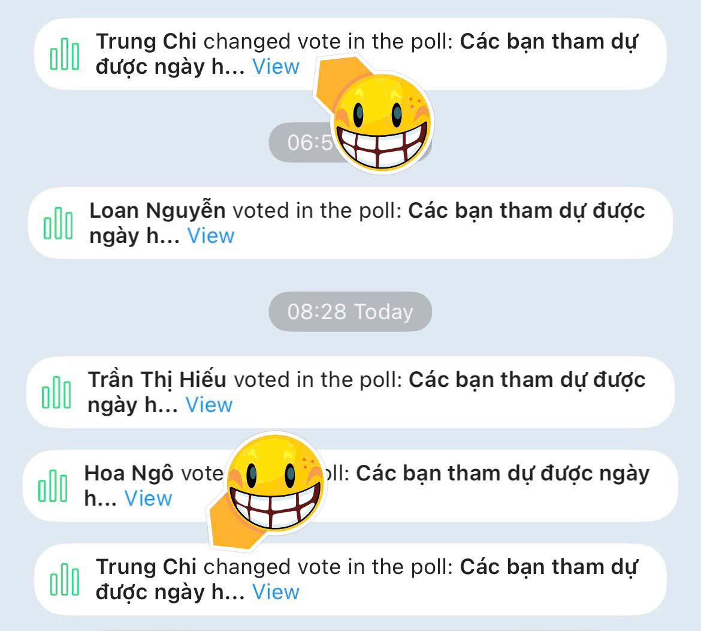
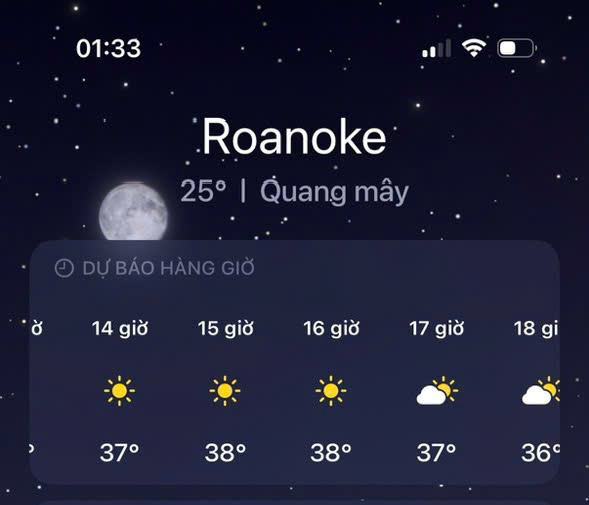
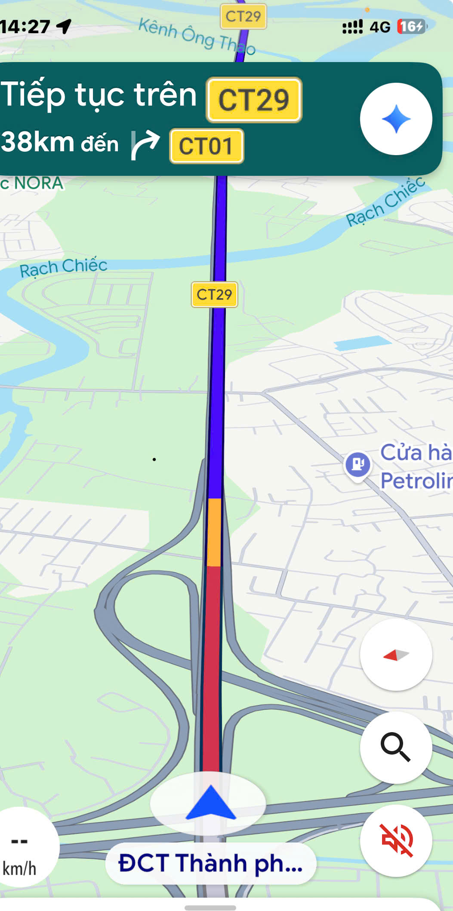

# {{ $frontmatter.title }}  
*Tác giả: {{ $frontmatter.author }}*   
*Ngày: {{ formattedDate }}*

---  

Chí Trung hạ thủ liên hoàn,  
Đón chào đợt nắng bên Roan nô kề  
Nam tèo nghe có cà phê  
Hết ga hết số chạy về Cam Ranh.  

Bảo đại dở thói lưu manh  
Bay ba mươi phút kéo chân Nam tèo.  
Ông trời nghe thấy,,, mày nheo  
Chút Tao xả nước,,, ướt mèm tụi bây,,,  

Mưa thì cũng có cái hay  
Rủ nhau ra tắm như ngày còn thơ.  
Cứ cho Bảo đại nằm mơ  
Giật mình tỉnh giấc,,, thơ hay mơ này,,,  

Kế bên thửa ruộng chưa cày  
Lo mà xốc cuốc, kéo cày nhanh nhanh  
Nam tèo cứ nghĩ mình lanh  
Sớn xơ, sớn xác,,, đạp nhầm cái gai,,,  

Kẽm ơi đường hãy còn dài  
Mau lo xuất phát để mai hẹn rồi.  
Vé xe đã book sẵn rồi  
Khuya nay họ rước,,, mai ngồi với nhau  

*Tác giả: {{ $frontmatter.author }}*   
Ngày: {{ formattedDate }}

---  

<figure style="text-align: center;">
  
  <figcaption>Chí Trung hạ thủ liên hoàn</figcaption>
</figure>   

<figure style="text-align: center;">
  
  <figcaption>Đón chào đợt nắng bên Roan nô kề </figcaption>
</figure>   

---  

<figure style="text-align: center;">
  
  <figcaption>Nam tèo nghe có cà phê   
Hết ga hết số chạy về Cam Ranh.</figcaption>
</figure>   