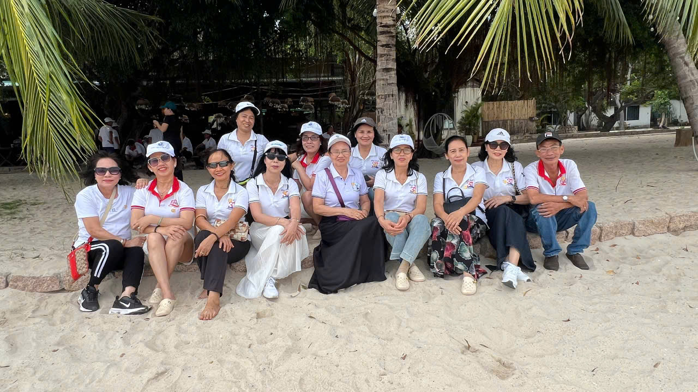
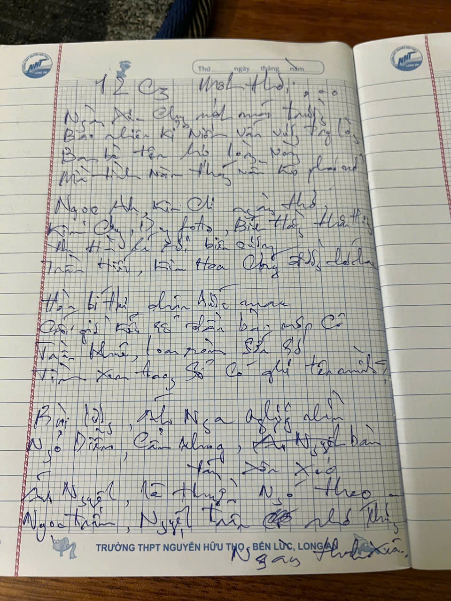

# {{ $frontmatter.title }}  
*Tác giả: {{ $frontmatter.author }}*   
*Ngày: {{ formattedDate }}*

---  

Ngày xưa, chung một mái trường  
Bao nhiêu kỷ niệm vấn vương trong lòng  
Bạn bè tên họ lòng vòng  
Mà tình năm tháng vẫn không phai mờ

Ngọc Anh, Kim Chi ngày thơ  
Kim Chung, Dung photo, Bích Hằng thân thương  
Thu Hà lá rơi biên cương  
Kim Hoa, Trần Hiếu chung đường nhớ nhau  

Hòa bí thư chân bước mau  
Cuối giờ kết sổ đầu bài nộp Cô  
Trần Khuê, Loan ròm  sớn sơ  
Thanh Huyền, Hương Nguyễn lơ mơ tên mình  

Bùi Lương, Ánh Nga ngước nhìn  
Ngỏ Diễm, Cẩm Nhung bàn tán xôn xao  
Ánh Nguyệt, Lê Thuyền  ngó theo  
Ngọc Trâm, Nguyệt Trân ,,, có nhớ những ngày thanh xuân ?  

Bảo đại, Bình điện ân cần,   
Tám bom, Chương chuột bao lần đùa vui  
Hải trên, Hải dưới ngọt bùi  
Hoàng táo, Hùng rụng, tiếng cười còn đây.  

Hùng nọc, Hùng quẹo những ngày,   
Kính đắc, Lân chị, Lễ bu sum vầy  
Minh cole, Minh dảnh, Nam tèo đâu đây,  
Oanh Trần, Phượng quý nhớ ngày bên nhau.  

Sô tấn, Tài heo trước sau,  
Tam đợt, Tâm caro, một màu thân thương.  
Tú bà, Thái duối, chung đường  
Thạch Trương, Triều lai vấn vương nghĩa tình.  

Trung ba trợn, Trực kẽm, Trực nguyễn  
Văn chị - Bé Phan thân thuộc ngày xưa,  
Dẫu cho năm tháng nắng mưa,  
Tình bạn vẫn đẹp như vừa hôm qua.  

Có người giờ đã đi xa,  
Không còn gặp mặt, nhưng ta vẫn chờ...  
Chờ trong ký ức tuổi thơ,  
Chờ trong ánh mắt, trong giờ gặp nhau.  

Lớp mình - một thuở hôm nào  
Một đời thương nhớ, một lần thanh xuân  
Dẫu cho tóc bạc mái đầu,  
Tình xưa nghĩa cũ trước sau vẹn tròn.  

*Tác giả: {{ $frontmatter.author }}*   
Ngày: {{ formattedDate }}

